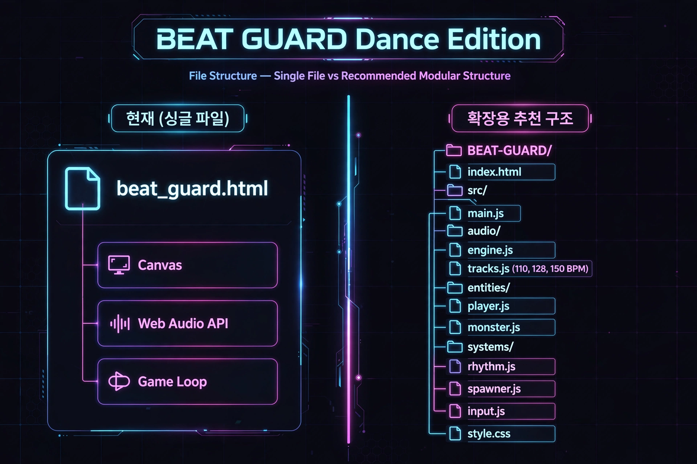

# BEAT GUARD - Dance & 2P Battle Edition 🎮💃

> 안산에서 만든 네온 리듬 디펜스 게임. 박자에 맞춰 몬스터를 막아라!



**🔴 LIVE DEMO:** `https://YOUR_USERNAME.github.io/beat-guard/` ← GitHub Pages 켜면 여기 생김

---

## 🎵 댄스 트랙
| 트랙 | BPM | 컨셉 |
|------|-----|------|
| K-POP | 110 | 뉴진스 / 르세라핌 그루비 |
| HOUSE | 128 | 클럽 표준 |
| EDM | 150 | 페스티벌 메인 |

## 🎮 플레이 방법

### 1P DANCE
- A / ← : 왼쪽 방어
- D / → : 오른쪽 방어
- 스페이스 : 긴급 양쪽 방어

### 2P BATTLE (한 키보드)
- **P1 (청록)**: A = 왼쪽, D = 오른쪽, Q = 긴급
- **P2 (마젠타)**: ← = 왼쪽, → = 오른쪽, ↑ = 긴급
- 60초 타임어택, 점수 높은 사람이 승리 / HP 0이면 KO

### 판정
- PERFECT (±80ms) : 100점 + 콤보
- GOOD (±150ms) : 50점
- MISS : HP -1

---

## 📁 파일 구조

```
beat-guard/
├── index.html              # 게임 본체 (싱글파일, 올인원)
├── README.md               # 이 파일
├── docs/
│   └── file-structure.png  # 파일구조도
└── .gitignore
```

### 현재 (싱글 파일) vs 확장용 추천 구조

> **현재:** `index.html` 하나에 전부 포함
> - Canvas 렌더링
> - Web Audio API (BPM 110/128/150 생성)
> - Game Loop / Input / Spawner

> **확장할 때 이렇게 나누면 좋아요:**
```
BEAT-GUARD/
├── index.html
├── src/
│   ├── main.js
│   ├── audio/
│   │   ├── engine.js
│   │   └── tracks.js (110, 128, 150 BPM)
│   ├── entities/
│   │   ├── player.js
│   │   └── monster.js
│   └── systems/
│       ├── rhythm.js
│       ├── spawner.js
│       ├── input.js
│       └── score-graph.js (점수 막대그래프)
├── style.css
└── assets/
```

---

## 🚀 GitHub Pages에 올리는 법 (3분)

1. 이 레포를 GitHub에 새로 만들기 (Public)
2. 파일 전부 업로드 (드래그앤드롭)
3. Settings > Pages > Source: `main` / `/(root)` 선택 > Save
4. 1~2분 후 `https://YOUR_USERNAME.github.io/beat-guard/` 에서 플레이!

## 🔥 올리고 나서 하면 재밌는 거

- [ ] **랭킹표 만들기** - README에 Top 5 점수 적기
- [ ] **Issues 배틀** - 친구가 "P1 밸런스 패치 좀" 하면 고치기
- [ ] **PR로 트랙 추가** - 친구가 좋아하는 노래 BPM으로 새 트랙 PR
- [ ] **점수 그래프** - 다음 업데이트: 실시간 VS바 + 타임라인 차트
- [ ] **스킨 추가** - 안산 스킨 (대부도 포도, 시화호 노을, 다문화거리)
- [ ] **Star 모으기** - Star 10개면 모바일 앱 포팅!

## 🛠️ 다음 업데이트 TODO
- [ ] 점수 막대그래프 (실시간 VS바, 타임라인)
- [ ] 커스텀 노래 BPM 분석기
- [ ] 모바일 세로모드 최적화
- [ ] 로컬 랭킹 localStorage 저장

---

Made with 💜 in Ansan, Gyeonggi-do
BPM 110/128/150 Dance Edition
